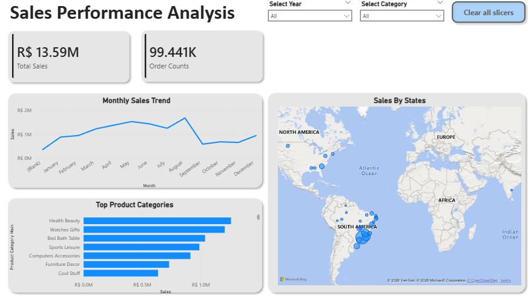
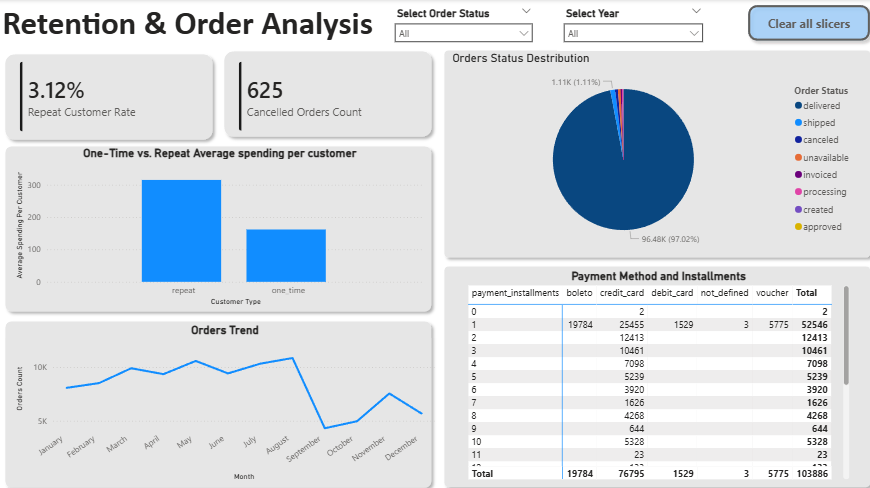

# E-commerce Revenue, Delivery & Retention Analysis

## Project Overview

This project analyzes the Olist Brazilian e-commerce dataset to explore sales performance, delivery performance, customer satisfaction, repeat purchasing, and payment-related order issues.

The goal is to use data analysis to identify business patterns, highlight potential operational issues, and communicate findings through SQL analysis and an interactive Power BI dashboard.

## Tools Used

- **Python:** Dataset inspection and data understanding using Jupyter Notebook and pandas.
- **SQL (PostgreSQL):** Business queries, joins, aggregations, and analysis.
- **Power BI:** Interactive dashboard and visual reporting.

## Business Questions

### 1. Sales Performance
- How do sales and order volumes change over time?
- Which product categories and customer states contribute the most sales?
- Are there unusual monthly sales patterns?

### 2. Delivery Performance
- What proportion of orders arrive later than estimated?
- How does on-time delivery vary by state?
- How early or late are orders delivered relative to their estimated dates?

### 3. Customer Satisfaction
- What is the average review score?
- How do review scores differ between late and on-time deliveries?
- Which product categories receive lower review scores?

### 4. Customer Retention
- What proportion of identifiable customers place multiple orders?
- How does spending differ between one-time and repeat customers?
- How are repeat-customer records distributed across states?

### 5. Payment & Order Issues
- What are the order-status and cancellation patterns?
- How do payment methods and installment choices vary?
- What payment value is associated with canceled orders?

## Power BI Dashboard

### Sales Performance

### Delivery Performance

### Customer Retention

## Key Findings

- 8.11%
Late deliveries
Delivery performance and customer experience

8.11% of delivered orders arrived after their estimated delivery date. The average review score was 2.57/5 for late deliveries, compared with 4.29/5 for on-time deliveries. This is an association, not proof that delivery delays alone caused lower ratings.

- 3.12%
Repeat customers
A potential retention opportunity

Only 3.12% of identifiable customers placed multiple orders in your analysis. Repeat customers averaged 2.12 purchases and R$314.99 spending per customer, compared with R$161.82 per one-time customer. That suggests a retention opportunity to investigate; it doesn't establish why customers did or didn't return.

- 21.05 pp
State delivery gap
Delivery performance varies geographically

The on-time delivery rate ranged from 97.12% in RO to 76.07% in AL, a gap of 21.05 percentage points. This flags locations for further investigation, while delivery volumes should be considered when comparing states.

- R$162,591.95
Payment discrepancy
A data-quality issue discovered through SQL

Your investigation found 830 order IDs present in the payments table without matching order-item records. Their associated payment value was R$162,591.95. An inner join excluded these unmatched orders, illustrating why table grain and join coverage matter before comparing totals.

- R$1.26M
Top category sales
Sales concentration and unusual periods

Health & Beauty was the highest-sales category at R$1,258,681.34, while (SP) led state sales at R$5,202,955.05. September 2018 sales fell to R$145 across 16 orders, of which 15 were canceled. The small order count is important context for interpreting that apparent collapse.

## Project Structure

- `analysis/` — SQL scripts for the five business-question sections.
- `dashboard/` — Power BI dashboard file.
- `notebooks/` — Jupyter notebooks for dataset inspection and data understanding.
- `screenshots/` — Screenshorts of PowerBI dashboard
- `data/` — Local dataset files; excluded from the Git repository.

## Data & Limitations

The project uses the Olist Brazilian E-Commerce Public Dataset. The original CSV files are not included in this repository.

Some orders have missing delivery timestamps, some orders have multiple payment or review records, and some payment records do not have corresponding order-item records. These limitations can affect certain calculations and interpretations. Observed relationships are treated as associations rather than proof of causation.

## Dashboard

Open `dashboard/analysis_dashboard.pbix` using Microsoft Power BI Desktop to explore the report.

## Data Source

Olist Brazilian E-Commerce Public Dataset: [Kaggle — Brazilian E-Commerce Public Dataset by Olist](https://www.kaggle.com/datasets/olistbr/brazilian-ecommerce)
